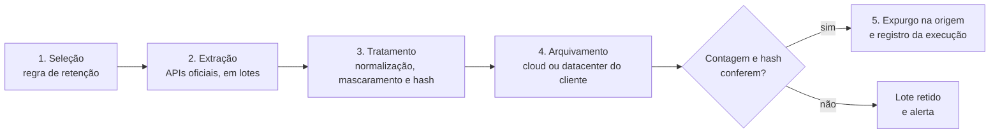

# Alsync

**Expurgo e arquivamento seguro de dados, desenvolvido pela Alpar.**

O Alsync retira registros históricos das plataformas corporativas, trata cada lote com segurança e arquiva tudo no ambiente do próprio cliente. A plataforma de origem fica mais leve, o custo de armazenamento cai e o histórico continua disponível para consulta, auditoria e indicadores.

> Sua instância leve. Seus dados na sua cloud.

---

## Por que usar

| | |
| --- | --- |
| **Plataforma mais leve** | Tabelas grandes, como as de auditoria e de histórico de chamados, diminuem. Listas, buscas e relatórios respondem mais rápido. |
| **Menos custo de storage** | O histórico sai do armazenamento da plataforma, que é caro, e vai para o storage da cloud do cliente. |
| **Retenção sob regra** | Cada tabela segue a política de retenção definida pelo cliente, e cada execução fica registrada para auditoria. |
| **Histórico que gera valor** | Os dados arquivados ficam em formato aberto, prontos para análise e indicadores estratégicos. |

## Como funciona

Toda execução passa pelas mesmas cinco etapas. Um registro só é removido da origem depois que a cópia no destino é conferida.



1. **Seleção:** a regra define a tabela, o filtro e a idade. Exemplo: chamados fechados há mais de 24 meses.
2. **Extração:** os registros são lidos em lotes, pelas APIs oficiais da plataforma de origem, em janelas de baixa carga.
3. **Tratamento:** os campos são padronizados, os dados pessoais são mascarados quando necessário e cada lote recebe um hash.
4. **Arquivamento:** os dados vão para o storage ou banco de dados do cliente, em formato aberto e consultável.
5. **Expurgo:** com a contagem e o hash conferidos, os registros são removidos da origem e a execução é registrada.

## Segurança

- **Dado sob controle do cliente:** o destino é a cloud ou o datacenter do próprio cliente.
- **Criptografia** em trânsito, entre origem e destino, e em repouso, no destino.
- **Integridade por hash:** a remoção na origem só acontece quando contagem e hash batem no destino.
- **Acesso mínimo:** as contas de serviço só têm permissão nas tabelas da regra, e as credenciais ficam em um cofre de segredos.
- **Trilha de auditoria:** cada execução registra quem aprovou, o que foi movido, quanto e quando. O log pode ser exportado para o SIEM do cliente.
- **Privacidade e LGPD:** campos pessoais podem ser mascarados ou anonimizados, e os dados são descartados de vez quando o prazo legal termina.

Exemplo do registro de um lote:

```text
2026-10-18T02:14:07Z  job=chamados-24m   lote=38/52
origem     plataforma://prod/chamados   registros=50000
destino    cliente-storage/archive/chamados/2024/
sha256     9f2c…e41a   conferido
contagem   origem=50000  destino=50000  ok
expurgo    liberado   aprovador=gestao.ti@cliente
```

## Indicadores (serviço agregado)

Com o histórico arquivado em formato aberto, a equipe Alpar monta modelos e painéis que cruzam anos de operação:

- **Operação:** MTTR, backlog, reabertura e cumprimento de SLA por grupo.
- **Problemas e causa raiz:** recorrência por item de configuração.
- **Atendimento e CRM:** ciclo de casos, churn por segmento e histórico por conta.
- **Capacidade e custo:** crescimento de tabelas, previsão de storage e economia gerada por expurgo.
- **Conformidade:** relatórios de retenção e descarte para auditoria e LGPD.
- **Base para IA:** histórico limpo e estruturado para modelos de classificação e previsão.

## Implantação

| | On-premises | Cloud gerenciada pela Alpar |
| --- | --- | --- |
| **Onde o dado fica** | Datacenter do cliente | Conta de cloud do cliente (AWS, GCP ou Azure) |
| **Quem opera** | Equipe do cliente, com suporte da Alpar | Equipe Alpar |
| **Atualizações** | Pacotes entregues pela Alpar | Aplicadas pela Alpar |
| **Monitoramento** | Ferramentas do cliente | Alpar, com relatório periódico |
| **Analytics agregado** | Opcional | Opcional |

## Produtos relacionados

- **Alsync:** expurgo e arquivamento de dados.
- **Datalake:** destino e base analítica para o histórico arquivado.

```js
const time = {
  empresa:  "Alpar",
  squad:    "Tech & Dev",
  produtos: ["Alsync", "Datalake"],
  clouds:   ["AWS", "GCP", "Azure"],
  status:   "em produção"
};
```

## Contato

Quer ver o Alsync funcionando com os dados da sua empresa?

- **E-mail:** contato@alpar.com.br
- **Telefone:** +55 11 3644-5057
- **Site:** [alpar.com.br](https://alpar.com.br/)

---

<sub>Alsync é um produto desenvolvido pela Alpar · Tecnologia & Desenvolvimento.</sub>
